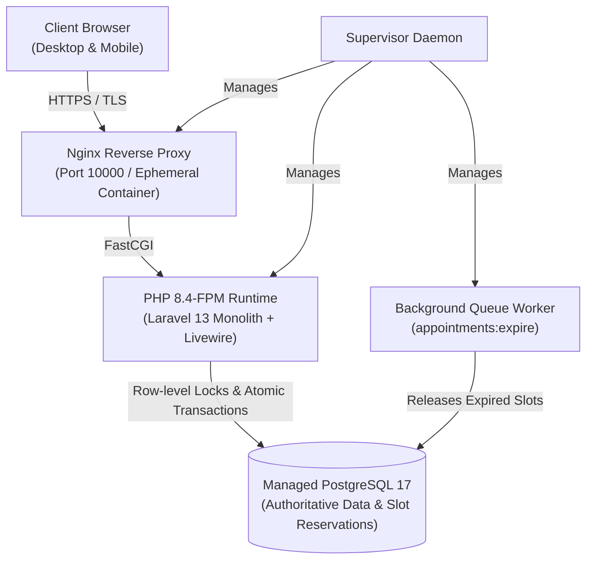
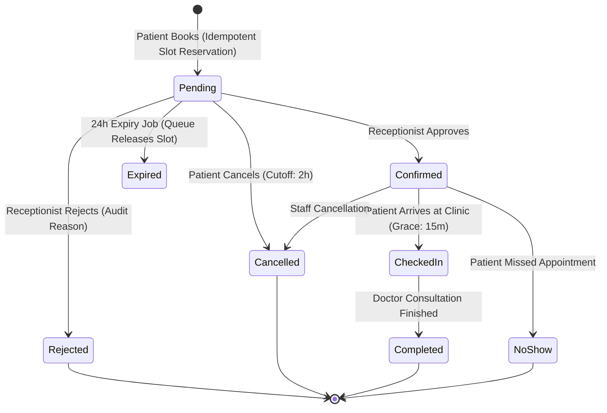

# Klinika — Healthcare Appointment & Clinic Operations Engine

<div align="center">

[](https://github.com/LuigiCarl/klinika-web/actions/workflows/tests.yml)


**A high-concurrency, production-engineered healthcare appointment booking and clinic management system built with Laravel 13, Livewire, Flux UI, and PostgreSQL.**

[Live Demo](https://klinika-web.onrender.com) · [Architecture & PRD](docs/ARCHITECTURE.md) · [Deployment Guide](docs/DEPLOYMENT.md)

</div>

---

## 🌟 Executive Summary & Engineering Highlights

Unlike standard CRUD applications, **Klinika** is engineered to solve the most difficult challenge in appointment booking: **concurrency-safe slot reservation under sub-second race conditions**. It guarantees zero double-bookings at the database level while providing real-time operations triage for clinic staff.

* **Atomic Slot Reservation Engine**: Eliminates double-bookings using PostgreSQL row-level locks (`SELECT ... FOR UPDATE`), atomic transactions, and unique slot reservation constraints (`(doctor_id, slot_starts_at)` and `(patient_id, slot_starts_at)`).
* **Live Clinic Triage**: Real-time queue polling (`wire:poll.10s`), synthesized Web Audio notifications, and active metrics for receptionists.
* **1-Click Demo Sandbox**: Evaluators can instantly switch between **Admin**, **Receptionist**, and **Patient** personas with zero password friction.
* **Clinical Manifest & Daily Schedule**: One-click CSV export and print-optimized clinic day schedules for doctor consultation rooms.
* **Production Docker Runtime**: Multi-stage Alpine containerization pairing Nginx, PHP 8.4-FPM, Supervisor, and managed PostgreSQL on Render.

---

## 🏛️ System Architecture



---

## 🔄 Appointment Lifecycle & State Machine

Every appointment follows a strict state transition matrix with immutable event history and audit logging:



---

## 🛡️ The Hard Problem Solved: Concurrency & Zero Double-Booking

### The Naive Approach That Fails
Many applications rely on simple application queries:
```php
// VULNERABLE TO RACE CONDITIONS:
if (Appointment::where('doctor_id', $doc)->where('starts_at', $time)->exists()) {
    return 'Slot taken';
}
Appointment::create([...]); // Two simultaneous requests both pass the check!
```

### Klinika's Two-Tier Integrity Boundary
1. **Pessimistic Row-Level Locking**: When calculating availability and reserving intervals, doctor schedule rows are locked with `lockForUpdate()`, serializing overlapping mutations within an atomic transaction.
2. **Database-Enforced Unique Reservation Tables**:
   - `doctor_slot_reservations`: Unique constraint on `(doctor_id, slot_starts_at)`
   - `patient_slot_reservations`: Unique constraint on `(patient_id, slot_starts_at)`
   - Even if two requests arrive at the exact same millisecond, PostgreSQL rejects the second insertion with a unique-violation exception, safely translated into an informative conflict response without exposing database errors.
3. **Idempotency Guard**: Every booking submission includes a client-generated UUID idempotency key, preventing accidental double-charges or duplicate appointments during network retries.

### 🔬 Run the Live Concurrency Simulation
You can test and observe race-condition prevention directly in your terminal:
```bash
php artisan clinic:simulate-concurrency --attempts=5
```
This command fires competing booking transactions targeting the exact same doctor time slot. It generates an audit report verifying that **1 transaction claims the reservation, 4 are gracefully caught, and exactly 1 appointment is persisted in the database with 0 double-bookings.**

---

## ⚡ 1-Click Interactive Demo Accounts

You can test all roles immediately using the **1-Click Demo Access** buttons on the login page, or via credentials:

| Role | Email | Password | Persona & Capabilities |
| :--- | :--- | :--- | :--- |
| **Admin** | `admin@example.com` | `password` | Specialties, doctor roster, working hours, breaks, and unavailability. |
| **Receptionist** | `receptionist@example.com` | `password` | Real-time pending queue, check-in desk, CSV export & daily manifest. |
| **Patient** | `patient@example.com` | `password` | 15/30/45/60m slot picker, booking receipt, self-service cancellation. |

*Note: When logged in, you can switch personas on-the-fly using the **"Switch Role (Demo)"** menu in your avatar dropdown without logging out.*

---

## 🛠️ Technology Stack

| Layer | Technologies |
| :--- | :--- |
| **Backend** | PHP 8.4, Laravel 13, Eloquent ORM |
| **Frontend** | Livewire 4, Flux UI, Alpine.js, Tailwind CSS v4 |
| **Database** | PostgreSQL 17 (production), SQLite / MariaDB (testing/local) |
| **Concurrency** | PostgreSQL transactions, `FOR UPDATE` pessimistic locks, unique reservation constraints |
| **Container & Ops** | Multi-stage Docker, Alpine Linux, Nginx, PHP-FPM, Supervisor |
| **Quality & Tests** | Pest PHP (132 tests), PHPStan Level 6, Laravel Pint |
| **Deployment** | Render Web Service + Managed PostgreSQL (`render.yaml`) |

---

## 🚀 Local Setup & Development

```bash
# Clone and install dependencies
git clone https://github.com/LuigiCarl/klinika-web.git
cd klinika-web
composer install
npm install

# Environment configuration
cp .env.example .env
php artisan key:generate

# Database migration and demonstration seeding
php artisan migrate --seed

# Build assets and start local server
npm run build
php artisan serve
```

---

## 🧪 Automated Testing & Verification Suite

The application maintains comprehensive test coverage across business boundaries, state transitions, security controls, and race conditions:

```bash
# Run full Pest test suite (132 tests)
php artisan test --compact

# Code style compliance
vendor/bin/pint --test

# Static analysis (0 errors)
vendor/bin/phpstan analyse
```

---

## 📦 Deployment to Render

This repository includes a production-ready Render Blueprint ([`render.yaml`](render.yaml)) configured with managed PostgreSQL, automated migrations, seeders, and environment secrets.

See the complete guide in [`docs/DEPLOYMENT.md`](docs/DEPLOYMENT.md).
